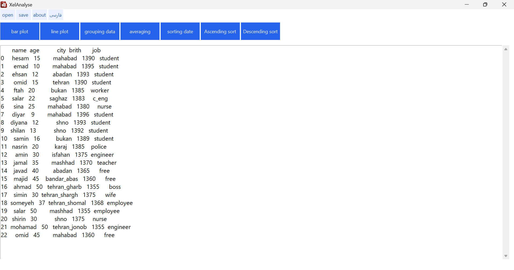

[English](README.md) | [فارسی](README_FA.md)
# XelAnalyse

**A Simple Desktop Application for Excel Data Analysis**

XelAnalyse is a Windows desktop application designed to make working with Excel data easier. It provides essential tools for analyzing, organizing, filtering, and visualizing spreadsheet data through a graphical user interface.

The application supports **English and Persian interfaces** and is intended for users who want to perform common data analysis tasks without writing code.

## Screenshots
### Main window

### Bar plot 

### Line plot 

## Features

- **Open Excel Files:** Load `.xlsx` and `.xls` spreadsheets.
- **Save Data:** Export the current dataset to an `.xlsx` file.
- **Bar Charts:** Visualize relationships between selected columns using bar charts.
- **Line Charts:** Create line charts from selected data columns.
- **Group Data:** Group rows by a selected column and calculate the number of rows in each group. Results are sorted by group size in descending order.
- **Calculate Averages:** Calculate the mean of a selected numeric column.
- **Sort Data:** Sort the current dataset by a selected column in ascending or descending order.
- **Filter by Date:** Filter rows using a date threshold calculated from a reference date and a specified number of months.
- **Bilingual Interface:** Switch between English and Persian.

## Download

Download the latest version of XelAnalyse from the **GitHub Releases** page.

1. Open the [Releases page](https://github.com/hesamghoreashy/XelAnalyse/releases).
2. Select the latest release.
3. Download the Windows installer, if available.
4. Run the installer and follow the on-screen instructions.
5. Launch XelAnalyse from the installed application or its shortcut.

> If the Releases page is unavailable, check the repository owner's profile for the correct project link.

## System Requirements

- **Operating system:** Windows 8 or later
- **Architecture:** 64-bit Windows
- **Installation:** Use the provided installer and follow its instructions.

The installer is intended to provide the files required to run the application. Users should not need to install Python separately when using a correctly packaged release.

## Getting Started

### 1. Open an Excel File

Launch XelAnalyse and use the **Open** option to select an Excel file with an `.xlsx` or `.xls` extension. The loaded data will be displayed in the application.

### 2. Create a Bar Chart

Enter the names of the columns to use for the X and Y axes in the corresponding fields, then select the chart creation option.

### 3. Create a Line Chart

Enter the names of the desired data columns and use the line chart option to visualize the data.

### 4. Group Data

Select the column by which you want to group the data. XelAnalyse calculates the number of rows in each group and sorts the results by count, from highest to lowest.

### 5. Calculate an Average

Enter the name of a numeric column and run the average calculation.

### 6. Sort Data

Enter a column name and choose ascending or descending order to sort the current dataset.

### 7. Filter by Date

Enter the reference year, month, and day, the number of months to subtract, and the name of the date column. The application filters the current dataset to keep rows whose dates are earlier than the calculated threshold.

### 8. Save Your Data

Use the **Save** option to export the current dataset to an Excel `.xlsx` file.

**Important:** Some operations, including grouping, sorting, and date filtering, change the dataset currently loaded in the application. Save the result if you want to keep those changes.

## Language Settings

XelAnalyse supports English and Persian. Use the language option in the application to change the language. Restart the application for the change to take effect.

## License

XelAnalyse is **proprietary software**. The source code is not publicly available, and publishing this repository does not make the software open source.

Use, copying, modification, redistribution, and other rights are governed by the license agreement distributed with the application. Please read that agreement before using or redistributing the software.

## Developer

**Hesam Ghoreashy**

- GitHub: [@hesamghoreashy](https://github.com/hesamghoreashy)
- LinkedIn: See the LinkedIn link on my GitHub profile.

For bug reports, feature requests, or suggestions, please use the **Issues** section of this repository if it is enabled.

## Disclaimer

XelAnalyse is provided under the terms of its accompanying license agreement. Always keep a backup of important data before performing data-processing operations.

---

© 2026 Hesam Ghoreashy. All rights reserved.