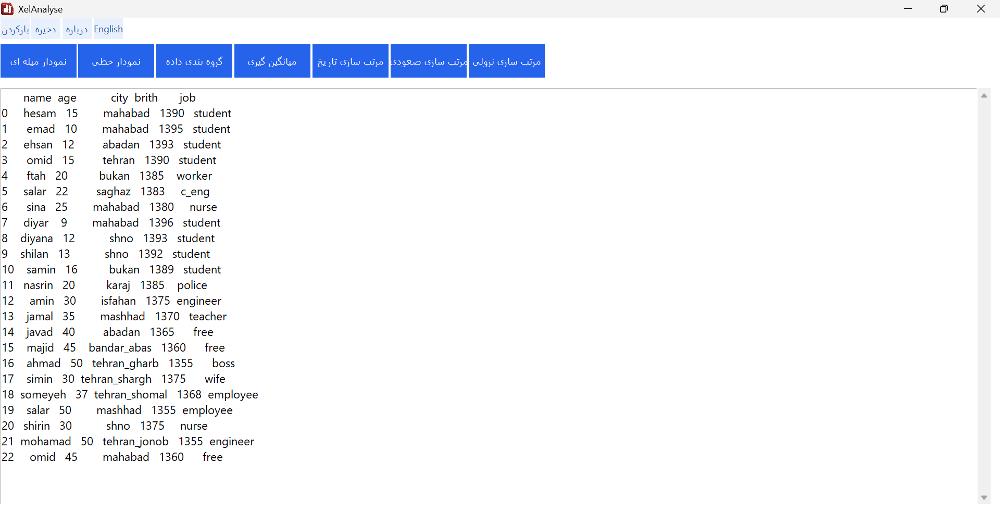
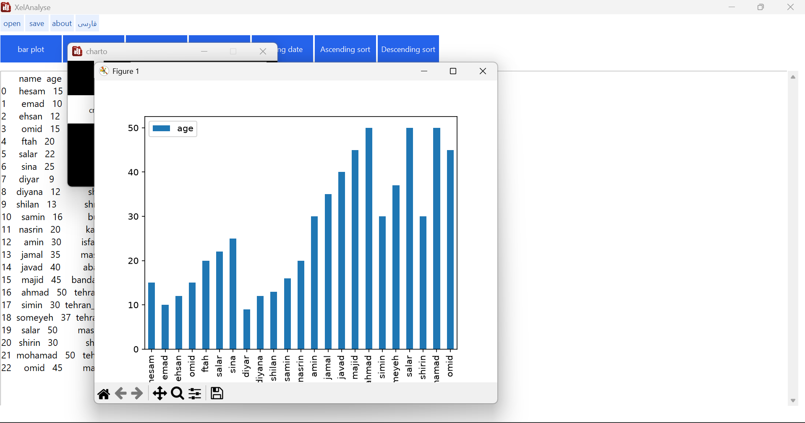
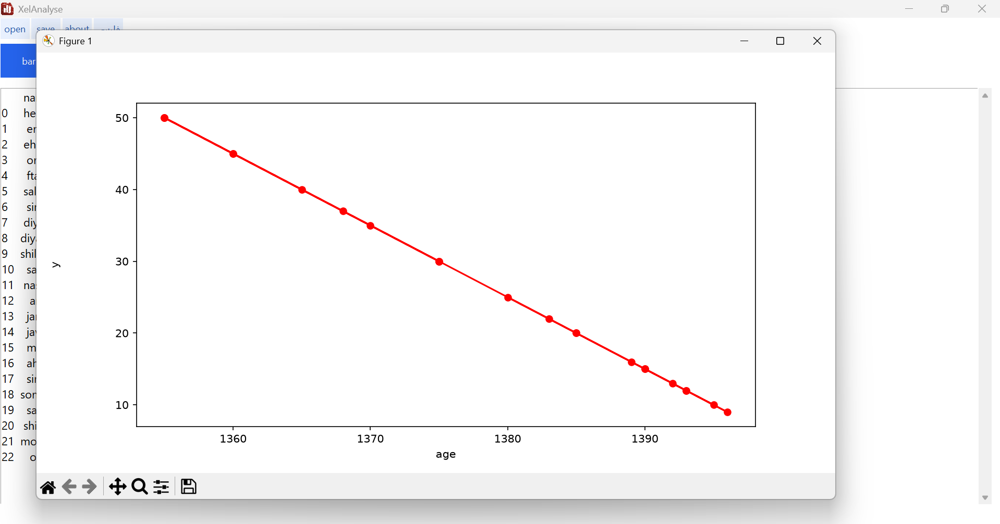

[English](README.md) | [فارسی](README_FA.md)
# XelAnalyse

**نرم‌افزار دسکتاپ تحلیل و بررسی داده‌های اکسل**

XelAnalyse یک نرم‌افزار دسکتاپ برای ویندوز است که با هدف ساده‌تر کردن کار با داده‌های اکسل طراحی شده است. این برنامه ابزارهای ضروری برای تحلیل، سازمان‌دهی، فیلترکردن و مصورسازی داده‌ها را از طریق یک رابط کاربری گرافیکی فراهم می‌کند.

XelAnalyse از رابط کاربری فارسی و انگلیسی پشتیبانی می‌کند و برای کاربرانی طراحی شده است که می‌خواهند بدون نوشتن کد، عملیات متداول تحلیل داده را انجام دهند.
## نمای برنامه
### پنجره اصلی

### نمودار میله ای

### نمودار خطی

## قابلیت‌ها

- **بازکردن فایل‌های اکسل:** خواندن فایل‌های با پسوند `.xlsx` و `.xls`.
- **ذخیره داده‌ها:** ذخیره مجموعه‌داده فعلی در قالب `.xlsx`.
- **رسم نمودار میله‌ای:** نمایش داده‌ها با انتخاب ستون‌های موردنظر.
- **رسم نمودار خطی:** مصورسازی داده‌های انتخاب‌شده با نمودار خطی.
- **گروه‌بندی داده‌ها:** گروه‌بندی ردیف‌ها بر اساس یک ستون و محاسبه تعداد ردیف‌های هر گروه؛ نتایج بر اساس تعداد، از بیشترین به کمترین مرتب می‌شوند.
- **محاسبه میانگین:** محاسبه میانگین یک ستون عددی.
- **مرتب‌سازی داده‌ها:** مرتب‌سازی مجموعه‌داده فعلی بر اساس یک ستون، به‌صورت صعودی یا نزولی.
- **فیلتر تاریخ:** فیلترکردن ردیف‌ها بر اساس یک تاریخ مرجع و تعداد ماه‌های موردنظر.
- **رابط کاربری دوزبانه:** امکان انتخاب زبان فارسی یا انگلیسی.

## دانلود

برای دریافت آخرین نسخه XelAnalyse به صفحه انتشار نسخه‌ها در GitHub مراجعه کنید.

۱. وارد [صفحه Releases](https://github.com/hesamghoreashy/XelAnalyse/releases) شوید.

۲. آخرین نسخه منتشرشده را انتخاب کنید.

۳. در صورت وجود، نصب‌کننده ویندوز را دانلود کنید.

۴. فایل نصب را اجرا کنید و مراحل نصب را دنبال کنید.

۵. برنامه را از محل نصب یا میان‌بر آن اجرا کنید.

> اگر صفحه Releases در دسترس نبود، از طریق پروفایل سازنده، نشانی صحیح مخزن برنامه را پیدا کنید.

## حداقل نیازمندی‌ها

- **سیستم‌عامل:** ویندوز ۸ یا جدیدتر
- **معماری:** ویندوز ۶۴ بیتی
- **نصب:** استفاده از نصب‌کننده ارائه‌شده و دنبال‌کردن دستورالعمل‌های آن

در نسخه بسته‌بندی‌شده، فایل‌های موردنیاز برنامه باید همراه نصب‌کننده ارائه شوند؛ بنابراین در صورت بسته‌بندی صحیح، نصب جداگانه پایتون برای اجرای برنامه لازم نیست.

## راهنمای استفاده

### ۱. بازکردن فایل اکسل

برنامه XelAnalyse را اجرا کنید و از گزینه **Open** برای انتخاب فایل اکسل با پسوند `.xlsx` یا `.xls` استفاده کنید. داده‌های بارگذاری‌شده در محیط برنامه نمایش داده می‌شوند.

### ۲. رسم نمودار میله‌ای

نام ستون‌های موردنظر برای محورهای X و Y را در فیلدهای مربوط وارد کنید و گزینه ایجاد نمودار را انتخاب کنید.

### ۳. رسم نمودار خطی

نام ستون‌های داده موردنظر را وارد کنید و از گزینه رسم نمودار خطی برای نمایش داده‌ها استفاده کنید.

### ۴. گروه‌بندی داده‌ها

ستونی را که می‌خواهید داده‌ها بر اساس آن گروه‌بندی شوند مشخص کنید. برنامه تعداد ردیف‌های هر گروه را محاسبه کرده و نتایج را از بیشترین تعداد به کمترین مرتب می‌کند.

### ۵. محاسبه میانگین

نام یک ستون عددی را وارد کنید و عملیات محاسبه میانگین را اجرا کنید.

### ۶. مرتب‌سازی داده‌ها

نام ستون موردنظر را وارد کنید و ترتیب صعودی یا نزولی را انتخاب کنید تا داده‌های فعلی بر اساس آن مرتب شوند.

### ۷. فیلترکردن بر اساس تاریخ

سال، ماه و روز تاریخ مرجع، تعداد ماه‌هایی که باید از آن کم شود و نام ستون تاریخ را وارد کنید. برنامه ردیف‌هایی را نگه می‌دارد که تاریخ آن‌ها از تاریخ محاسبه‌شده زودتر باشد.

### ۸. ذخیره داده‌ها

با استفاده از گزینه **Save** می‌توانید مجموعه‌داده فعلی را در قالب فایل اکسل `.xlsx` ذخیره کنید.

**نکته مهم:** برخی عملیات مانند گروه‌بندی، مرتب‌سازی و فیلتر تاریخ، داده‌های فعلی داخل برنامه را تغییر می‌دهند. اگر می‌خواهید نتیجه تغییرات را نگه دارید، آن را ذخیره کنید.

## تغییر زبان برنامه

XelAnalyse از زبان‌های فارسی و انگلیسی پشتیبانی می‌کند. از گزینه تغییر زبان در برنامه استفاده کنید. برای اعمال تغییر زبان، برنامه را مجدداً اجرا کنید.

## مجوز استفاده

XelAnalyse یک **نرم‌افزار اختصاصی و غیرمتن‌باز** است. کد منبع آن به‌صورت عمومی منتشر نشده و عمومی‌بودن مخزن GitHub به معنی متن‌بازبودن نرم‌افزار نیست.

شرایط استفاده، کپی‌برداری، تغییر، بازتوزیع و سایر حقوق مربوط به نرم‌افزار تابع توافق‌نامه مجوز همراه برنامه است. پیش از استفاده یا بازتوزیع نرم‌افزار، آن توافق‌نامه را مطالعه کنید.

## توسعه‌دهنده

**Hesam Ghoreashy**

- گیت‌هاب: [@hesamghoreashy](https://github.com/hesamghoreashy)
- لینکدین: از لینک LinkedIn موجود در پروفایل GitHub من بازدید کنید.

برای گزارش خطا، پیشنهاد قابلیت جدید یا ارائه بازخورد، در صورت فعال‌بودن بخش Issues، از آن در مخزن پروژه استفاده کنید.

## سلب مسئولیت

استفاده از XelAnalyse تابع شرایط توافق‌نامه مجوز همراه برنامه است. پیش از انجام عملیات پردازش داده، همیشه از اطلاعات مهم خود نسخه پشتیبان تهیه کنید.

---

© 2026 Hesam Ghoreashy. تمامی حقوق محفوظ است.